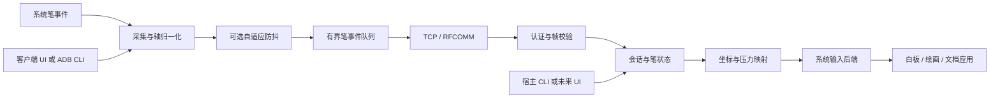

# 架构与技术选择

Reflection 把平板看成笔样本来源，把电脑看成输入接收与映射宿主。
界面只负责展示状态和调用控制接口，不承担协议解析、坐标转换或系统输入。

## 数据流

线上的协议只包含平台无关数据。它没有 Android MotionEvent、CGEvent、
Windows 结构体的二进制内存布局，也不传屏幕截图。更换 UI 或系统输入后端
不应要求更改客户端。

## 原生实现

| 部分 | 选择 | 原因 |
| --- | --- | --- |
| Android | Java、标准 View、MotionEvent、Socket / BluetoothSocket | 直接访问笔轴、历史样本和旧系统接口，减少运行时与 UI 依赖 |
| macOS | Swift、Network、CryptoKit、Quartz、IOBluetooth | 原生系统事件、权限、显示器、网络与蓝牙接口 |
| Windows | C++17、Win32、Winsock、BCrypt、Synthetic Pointer | 直接控制输入结构、物理像素映射和系统蓝牙通道 |
| 自动化工具 | Python 标准库 | 易审阅、跨平台、没有包管理器依赖；不参与生产笔事件路径 |

这不是语言性能排名。笔输入的瓶颈还可能在数字化器、Android 分发、无线重传、
目标应用和显示刷新。当前选择的重点是系统接口完整性、依赖可控和可测量性。
没有为了代码共享增加 FFI、JavaScript 桥或跨平台 UI 框架。

## 客户端边界

- `input`：将系统事件转换为不可变笔样本，处理历史样本、工具类型和异常轴。
- `core`：样本定义、可选坐标防抖与噪声校准、协议编码、认证和帧校验，不依赖 Activity。
- `transport`：TCP 与 RFCOMM 的流接口、工作线程、心跳、有界队列和重连。
- `control`：保存配置、连接控制和诊断；UI 与受保护 ADB Receiver 调用同一个控制器。
- `ui`：当前的演示面板和可选 Canvas 预览，可以独立替换。

笔尖位置按输入区域归一化。设备旋转后以新的区域重新开始笔画，避免跨坐标系
延续一条旧笔画。手指不会伪装成笔；当前不提供触控板手势。

网络读写不阻塞 Android UI 线程。队列上限为 256 个笔样本。队列满时断开并
释放会话，避免丢掉抬笔而造成鼠标一直按下。重连后等待新的落笔。

## 宿主边界

宿主各自维护配置模型、协议解析、映射核心和后端接口。原生 UI 可以直接依赖
这些库，不必通过 CLI 文本模拟操作。CLI 负责参数、进程生命周期和 JSON
输出；Windows 核心通过事件回调交给调用方展示。

macOS 的 `TabletBackend` 可替换为记录后端、Quartz 或后续虚拟设备实现。
Windows 的后端接口区分 dry-run 与 Synthetic Pointer。记录后端仍执行
认证、解析、映射与安全释放，便于无系统权限调试。

所有影响同一笔会话的状态按顺序处理。断线、超时、协议错误、取消和退出都
进入释放路径。握手只允许五秒；认证后无有效帧两秒则关闭连接。

macOS 的 RFCOMM 适配器把收到的有序字节流转入本机 TCP 会话，复用认证和
输入状态机。这会多经过一次本机套接字；应在真实蓝牙测量中单独评估，而非
把它称为零开销。Windows 与 Android 则直接复用流接口。

## 坐标与压感

客户端保留归一化坐标精度，可在发送前执行可关闭的坐标防抖；其他笔轴原样保留。
宿主集中执行映射：

1. 选择平板源区域。
2. 旋转坐标与倾斜方向。
3. 应用纵横比策略（macOS 可自动等比；Windows 通过区域设置控制比例）。
4. 映射到指定显示器或桌面矩形，或计算相对位移。
5. 以 `pow(pressure, gamma)` 应用压力曲线。
6. 转成目标系统接口要求的坐标和压力范围。

macOS 使用桌面逻辑坐标；Windows 使用物理像素并启用 DPI 感知。不要把两个
平台的目标区域数字直接照搬，尤其是在 Retina、缩放或多显示器环境中。

## 后端的实际含义

Quartz 和 Synthetic Pointer 都属于用户态注入。它们不自动注册一台可由任意
软件枚举的 HID 数位板，也不提供 WinTab 驱动接口。驱动路线保留为独立后端，
但需要单独解决安装、签名、操作系统兼容和升级问题。

相关系统接口的一手资料：

- [Android stylus advanced features](https://developer.android.com/develop/ui/views/touch-and-input/stylus-input/advanced-stylus-features)
- [Android MotionEvent](https://developer.android.com/reference/android/view/MotionEvent)
- [Apple CGEvent](https://developer.apple.com/documentation/coregraphics/cgevent)
- [Apple NSEvent](https://developer.apple.com/documentation/appkit/nsevent)
- [Microsoft CreateSyntheticPointerDevice](https://learn.microsoft.com/en-us/windows/win32/api/winuser/nf-winuser-createsyntheticpointerdevice)
- [Microsoft POINTER_PEN_INFO](https://learn.microsoft.com/en-us/windows/win32/api/winuser/ns-winuser-pointer_pen_info)
- [Microsoft Virtual HID Framework](https://learn.microsoft.com/en-us/windows-hardware/drivers/hid/virtual-hid-framework--vhf-)
