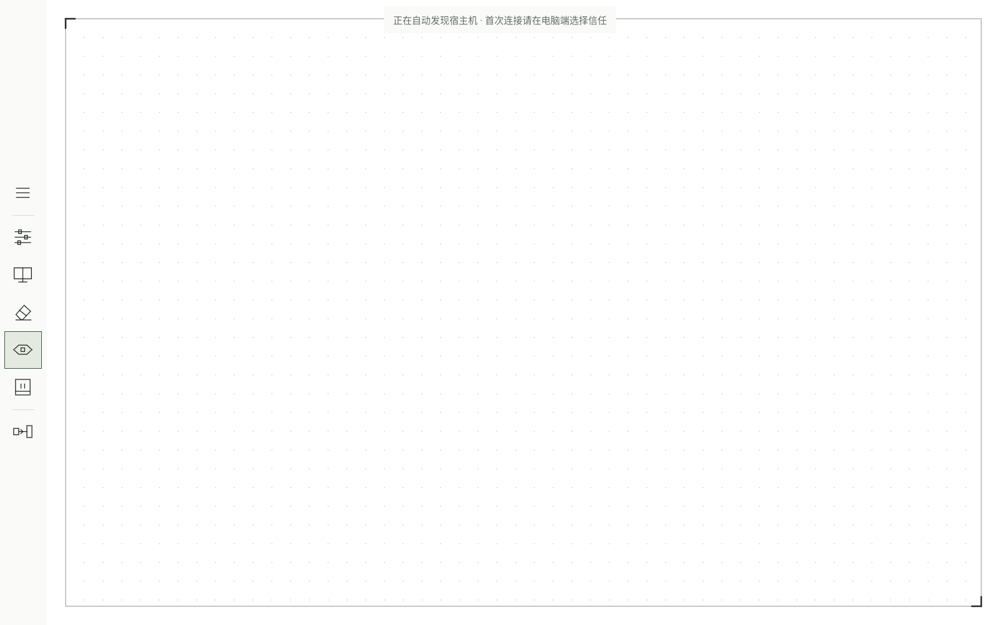
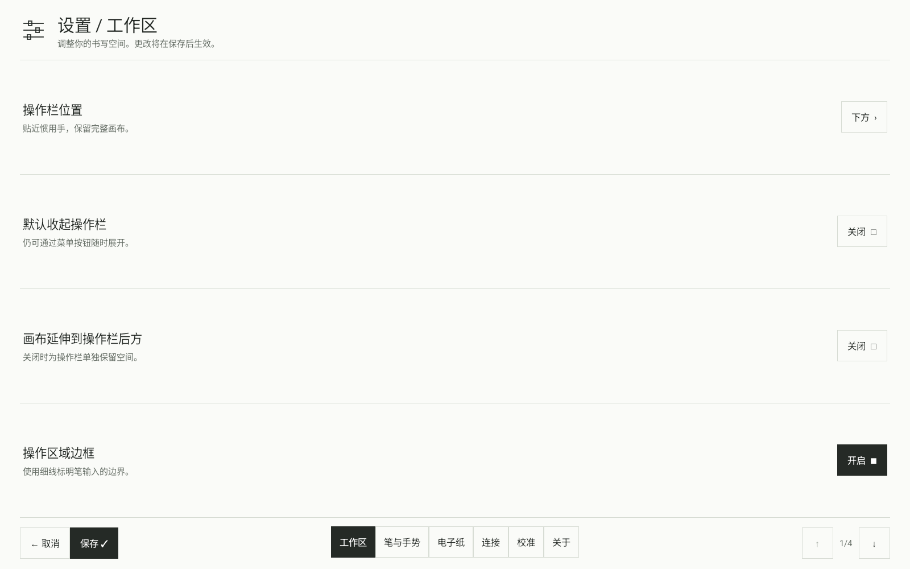
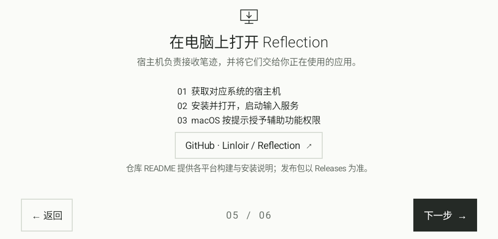

# 客户端体验

客户端以原生 Android View 实现，不依赖 WebView。界面使用直角线条图标、
细分隔线和留白；不使用卡片阴影或页面过渡动画。引导和设置底部都保留
左操作区、中间进度或分类区、右操作区。设置按可用高度分页，不需要滚动。
应用限定横屏，以 `userLandscape` 尊重系统旋转锁；解除锁定后可倒转横屏。

以下是 Android API 35 模拟器中的实际界面，分别展示工作区、分页设置与
320 dp 高度的引导；不是电子纸刷新效果的实拍。







## 第一次启动

六个引导页面依次为欢迎、五点位置校准、上下倾斜、左右倾斜、宿主机安装、
首次连接。没有采样数据时可跳过；采样完成后才能继续。重做清除对应项；
再次打开引导保留已经完成的校准。

位置校准要求每点至少 100 个不同时间戳样本和 1.2 秒接触。去除线性漂移后，
以 MAD 估计静止噪声。五个点拟合一个二维仿射修正；奇异布局、过大修正与
不一致点集被拒绝。校准点转换到面板固定坐标，避免工具栏或留白改变后偏移。
采样期间的笔画只留在本机，不传到电脑。

噪声先验随平板保留，在支持扩展的宿主机上按会话应用；电脑负责实际防抖，
不在两端重复平滑。倾斜校准分别记录优势轴与方向，不能凭空补出硬件缺失的轴。
例如仅提供一条通道的设备，第二个方向可能需要跳过。

## 书写空间

- 操作栏可位于底部或左侧，设置默认收起，或随时手动收起。
- 屏幕、清空、笔迹、触摸板按钮可分别隐藏；设置与连接入口保留。
- 支持空白、点阵、网格背景与不同间距。
- 四周留白和自定义矩形区域共同决定可输入范围；可选择是否覆盖工具栏。
- 可分别显示区域边框与全部屏幕映射时的显示器边界。
- 点击屏幕按钮可查看宿主实际显示器布局并选择单屏或全部屏幕。

本地笔迹与宿主输入互相独立。关闭本地笔迹不会停止电脑端的笔输入。
启用渐隐会同时启用本地笔迹。抬笔后停留 1、1.5 或 2 秒，再从末尾逐段消失；
电子纸使用较少灰阶段和较低刷新频率。详见 [电子纸适配](eink.md)。

## 边界切屏

需要同时满足单屏 focus、显示边框、四周至少 8 dp 留白和开启边界切换。
可选悬停、单击、双击、三击或笔侧键；悬停时间可配置。
方向依据宿主显示器真实位置，包括负坐标。没有对应方向邻屏时不循环跳转。
画布内已经开始的笔画不会因划到边界而切换。

## 触摸板

启用后，根据宿主实际协商的能力选择输入方式。支持新接口且成功创建触摸板的
Windows 11 宿主接收最多五指的原始触点，由系统识别移动、点击和手势。
物理尺寸、稳定触点 ID、历史采样与触点生命周期均单独传输。
一段手势固定使用同一后端，不会重复发送解释后的快捷操作。

旧版 Windows、接口不可用或创建失败时，以及 macOS，使用兼容方式：
单指移动指针，单指轻点左键，双指轻点右键；双指移动滚动，捏合触发应用缩放，
三／四指轻扫触发系统快捷操作。兼容方式不等同完整原生触控板的旋转、
缩放和自定义系统手势。macOS 完整原生手势尚未实现。

笔接近或接触时抑制手掌触摸；离开页面、禁用、断线、改变区域和取消手势都会
释放状态。Windows 原生路径已通过协议和状态检查、完整编译，但尚未在真实
Windows 系统验收手势识别。具体实现与边界见
[原生触摸板说明](native-touchpad-feasibility.md)和[协议](../protocol/README.md)。

## 连接与信任

平板自动发现电脑。首次局域网或蓝牙连接，在宿主机上选择设备、核对设备码并点击
“信任并连接”，平板确认新电脑。蓝牙先完成系统配对，通过独立 RFCOMM 服务进行
首次信任，无须先连接局域网或 USB。USB 使用系统已有的调试授权自动配置。
无需输入地址或配对密钥。信任可保存多台电脑；用户选择的电脑优先，再在
该电脑的 USB、Wi-Fi、蓝牙之间选优。详见 [连接方式](connectivity.md)。

引导、未连接提示与连接设置都提供设备设置入口，说明如何点击版本号开启
开发者模式与 USB 调试。Android 不允许普通应用直接开启调试，也没有跨厂商
统一的“版本号”控件跳转接口；打开系统“关于设备”页，不可用时回退系统设置。

## 保存与验证

设置在独立草稿中编辑。分类和分页保留草稿，只有保存才持久化；取消丢弃草稿。
校准是独立的引导操作，完成时保存结果，不属于设置草稿。

核心测试覆盖坐标拟合、旋转坐标往返、异常校准拒绝、显示器方位选择、触摸手势、
渐隐时序和协议。编译与模拟器界面检查不能替代真实文石刷新、物理倾斜、
蓝牙互通或 Windows/macOS 目标应用验收。

`client/android/tests/ui_smoke.py` 在指定的隔离 Android 模拟器上运行实际界面检查：
六页引导、注入笔事件完成五点校准、设置取消与保存、进程重启后的持久化，以及
窄横屏工具栏和设置分页。测试拒绝物理设备序列号；`--fresh-state` 只用于可丢弃的
模拟器，会清除其中 Reflection 的应用数据。构建并安装 APK 后从仓库根目录运行：

```sh
python3 client/android/tests/ui_smoke.py \
  --serial emulator-5556 --output .local/ui-test/screens --fresh-state
```

添加 `--compact-first-run` 可在 320 dp 高度完成同一套引导和短工具栏检查。
脚本另验证本地笔迹出现、超时消散，并恢复为原画布的相同截图。
截图和检查结果写入所选目录，模拟器显示尺寸在退出时恢复。
